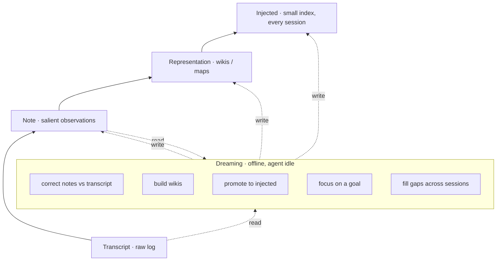
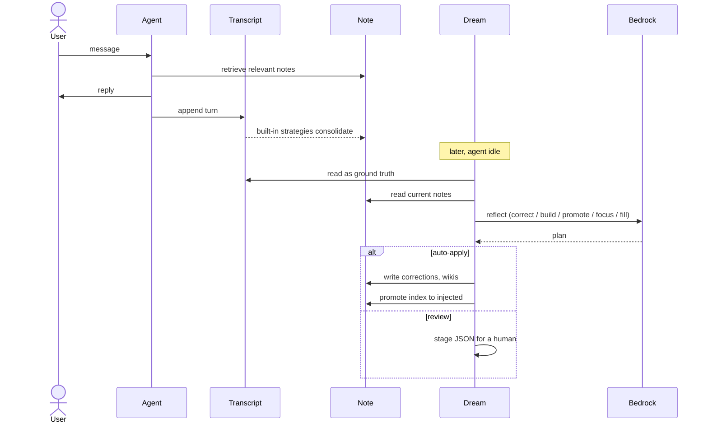

# Agent memory, built on Anthropic's "components of agent memory"

This project is a working build of the memory design Anthropic laid out in
[The components of agent memory](https://www.anthropic.com/research/components-of-agent-memory)
(Nov 6, 2026). It runs on [Strands Agents](https://strandsagents.com/) and
[Amazon Bedrock AgentCore Memory](https://docs.aws.amazon.com/bedrock-agentcore/latest/devguide/memory-strategies.html).

The article is the source of truth. The code here is one way to apply it. Read the
article first, then use this repo to see the ideas running.

Three parts below: what the article actually says, a live example of embedding it on
Strands and AgentCore, and what to do next.

---

## 1. What the article says

The core problem is a timing one. An agent has to decide what is worth remembering
during a session, before it knows what comes next. You cannot judge salience perfectly
in the moment. So the article splits memory into two jobs: capture now, organize later.

That second job is **dreaming**: an offline pass that reflects on the logs after the
fact, fixes what is wrong, and reorganizes what is kept. The analogy is sleep. The
hippocampus captures fast during the day, and the brain replays and consolidates into
the neocortex offline. Same split here.

### Memory is a hierarchy, not a store

Four layers, bottom to top:

| Layer | What it holds | Who writes it |
|---|---|---|
| Transcript | raw, searchable event log | the agent, as it runs |
| Note | salient observations the agent decides to keep | the agent, in-session |
| Representation | wikis and maps that link notes together | dreaming, offline |
| Injected | small index loaded into every session | dreaming, offline |

Lower layers are big and cheap to write. Upper layers are small, expensive, and
curated. Dreaming is what moves signal up the stack.



### Salience is a skill, and newer models have it

The Pokémon test makes the point. Sonnet 3.7 saved everything: 413 files, 225 folders,
one badge. It spent so long grooming notes it stopped playing. Fable 5 wrote 9 files
and a single `global.md`, and earned four badges. It only stored what the game would
not tell it again: strategy, plans, tested rules. The lesson is that good memory is
small and judged, not complete.

### Tell the model what memory is for, not how to use it

On CL-Bench, "a memory folder exists" was enough for strong models to build a real
learning loop (write a wrong answer, theorize, test, turn it into a rule). Hard rules
hurt. Telling Opus 5 to "record only failures" cut its memory gain by 0.234. Freedom to
judge beat fixed instructions for capable models. Older models needed more steering:
prompting Sonnet 4.6 to read its notes and test its theories nearly doubled its score.

### Memory is a prediction

Writing a rule is a bet that the pattern repeats. Writing a verified fact is a bet that
a future session will trust it without rechecking. That framing is why stale notes are
dangerous: a wrong bet gets read and believed later.

### What dreaming does, with evidence

- **Corrects notes.** In Pokémon, a note said the PokéCenter was on the wrong side of
  Mt. Moon. The agent trusted it, walked off a ledge, and never reached the next city.
  Dreaming checked the note against the transcript, caught the error, rewrote it, and
  the next run got through.
- **Builds representations (wikis).** On a 350k-file corpus, scaling dreaming from 2 to
  128 sessions took scores from 13% to 48%. Wiki plus a search tool beat search alone
  (61% vs 53%) and saved about 20k tokens per question.
- **Promotes notes up to the injected layer.** Keep this layer small or it stops
  working. Claude Code loads only the first 200 lines or 25 KB of `MEMORY.md` as an
  index. Dreaming keeps the top small by pushing detail down and leaving links.
- **Focuses memory on a goal.** On a contracts task, a shared summary page let agents
  overwrite each other and only 41 of 57 facts survived. Switching to one page per
  contract, quoting terms word for word, hit 57 of 57.
- **Fills gaps across sessions.** A single in-session view misses cross-session
  patterns and broken links. A second dreaming pass repointed nine dead wiki links and
  added a missing index.

### Open questions the article leaves

When to write memory (in-session steals attention, dreaming adds latency and compute),
how to keep it fresh without re-checking everything, how to tune dreaming cadence, and
how far plain transcript search can carry you before you need representations.

---

## 2. Embedding it on Strands and Bedrock AgentCore

The stack fits because AgentCore already splits memory the way the article does, and
Strands gives you the hooks to drive it.

### Layer mapping

| Article layer | This project | AgentCore mechanism |
|---|---|---|
| Transcript | `append_transcript` via the Strands session manager | short-term events |
| Note | built-in strategies (semantic, preference, summary, episodic) | long-term records, async |
| Representation | `build_wiki` in the dream job | long-term records in `wiki/` namespaces |
| Injected | `promote` in the dream job, size-capped | one record in `injected/` namespace |

The contract lives in `src/memory_backend.py`. It names the four layers and the five
reads and writes a store must support. AgentCore is the reference backend in
`src/backends/agentcore_backend.py`. Swap that one class for a vector DB, a git repo of
markdown, Mem0, or Zep and the rest does not change. That is the architectural point:
the hierarchy is the design, the store is an implementation detail.

### The live agent writes the bottom two layers

```python
agent = Agent(
    model=BedrockModel(model_id=config.bedrock_model_id, region_name=config.aws_region),
    system_prompt=SYSTEM_PROMPT,
    session_manager=AgentCoreMemorySessionManager(
        memory_id=config.memory_id,
        actor_id=config.actor_id,
        session_id=config.session_id,
        region_name=config.aws_region,
    ),
)
agent("I prefer metric units and short answers.")
```

Each turn lands in the transcript layer. AgentCore's built-in strategies turn turns
into notes in the background. Following the article, the system prompt tells the agent
what memory is for and leaves the judgment to it.

### Dreaming builds the top two layers, offline

`src/dream_job.py` implements the five operations as named functions, each one reading
the transcript as ground truth:

```python
from src.dream_job import correct_notes, build_wiki, promote, focus, fill_gaps, dream

dream()          # full cycle: correct, build, promote, focus, fill gaps
build_wiki()     # or run one operation
```

Set `DREAM_AUTO_APPLY=false` and each run writes a `dream_<op>_*.json` for you to
review instead of touching memory. Flip to `true` once you trust it. This is the
article's "update automatically, or review before it lands."



### Enterprise guidance

- Keep the injected layer on a hard character budget (`INJECTED_MAX_CHARS`). A wrong
  note here is read into every session, so it is the highest-risk layer.
- Gate dreaming with review before you let it auto-apply. Memory edits compound.
- Do not dream on thin data. Cross-session patterns need volume, or you get noise.
- Scope by `actorId`. Use a shared namespace only for learnings you want pooled across
  a team or a fleet of agents.
- Watch wiki size. The article saw a wiki grow to 1.77x the source corpus and abstract
  nothing. If the map is as big as the territory, it is not helping.
- Pick a cadence. Run dreaming where it pays off, not over everything every night.
  Focus it on memory that changes or gets accessed often.

---

## 3. What next

Start small and prove each layer before adding the next.

1. Run the live agent with transcripts and notes only. Confirm memory persists across
   sessions.
2. Turn on `correct_notes`. This is the cheapest win and it catches the stale-note
   failure the article shows in Pokémon.
3. Add `build_wiki` once you have real history, and pair it with search. Measure both
   against search alone before you trust it.
4. Add `promote` with a tight budget. Check adherence: a bigger index is not a better
   one.
5. Use `focus` for a specific job (a support queue, a deal room, one user) and set
   `DREAM_GOAL`.
6. Schedule `fill_gaps` as a second pass after wikis exist.

Anthropic's cookbooks are the reference implementations to compare against:
[dreaming with a dynamic workflow](https://platform.claude.com/cookbook/managed-agents-cma-dreaming-with-a-dynamic-workflow)
and [knowledge wikis](https://github.com/anthropics/claude-quickstarts/tree/main/managed-agents/knowledge-wiki).

---

## Layout

```
src/
  config.py                   env config
  memory_backend.py           the four-layer contract (the design)
  create_memory.py            AgentCore memory + strategies for the note layer
  agent.py                    live agent (transcript + note layers)
  dream_job.py                the five dreaming operations
  backends/agentcore_backend.py   reference backend
runtime_entrypoint.py         AgentCore Runtime entrypoint
Dockerfile                    arm64 image for Runtime
deploy/README.md              deploy to Runtime
deploy/schedule.md            schedule dreaming, cross-agent setup
```

## Quickstart

```bash
python -m venv .venv && source .venv/bin/activate
pip install -r requirements.txt
cp .env.example .env               # set region + model id

python -m src.create_memory        # prints MEMORY_ID, paste into .env
python -m src.agent                # chat; writes transcript + note layers
python -m src.dream_job            # offline pass; staged for review by default
```

Deploy: `deploy/README.md`. Schedule: `deploy/schedule.md`.

## Note on scope

This recreates the design from the article on Strands and AgentCore. It is not
Anthropic's managed dreaming and is not affiliated with Anthropic or AWS. "Dreaming"
and the four-layer hierarchy are from Anthropic's research, used here to describe the
pattern it introduced. Preview SDK names shift, so if an import breaks, the thin
wrappers in `agent.py` and `backends/agentcore_backend.py` are where you adjust.

## Sources

- [The components of agent memory](https://www.anthropic.com/research/components-of-agent-memory), Anthropic, Nov 6, 2026
- [Dreaming docs](https://platform.claude.com/docs/en/managed-agents/dreams)
- [Managed Agents memory](https://platform.claude.com/docs/en/managed-agents/memory)
- [AgentCore Memory strategies](https://docs.aws.amazon.com/bedrock-agentcore/latest/devguide/memory-strategies.html)
  and [built-in strategies](https://docs.aws.amazon.com/bedrock-agentcore/latest/devguide/built-in-strategies.html)
- [AgentCore Memory with Strands](https://builder.aws.com/content/3AiwZ4TE46VNMNhuMDJkWu2OD19/using-amazon-bedrock-agentcore-memory-with-strands-agents)
